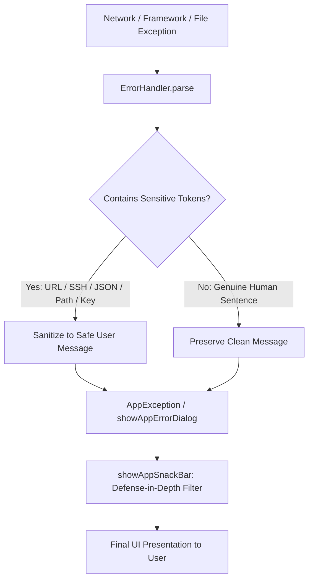

# Cyber Security & Information Disclosure Hardening Spec

## 1. Threat Model & Security Objectives

In client applications interacting with AI cloud infrastructure, raw error responses from servers, runtime exceptions, and socket failures frequently leak sensitive infrastructure details. This includes:
- Production API endpoints, backend domains, and staging URLs.
- Serverless orchestration hostnames (e.g. `*.vercel.app`).
- SSH keys, access tokens, API keys, or basic auth strings.
- Internal filesystem paths and local operating system directory names (`/storage/emulated/0/...`, `/data/user/0/...`, `C:\Users\...`).
- Raw database or JSON error payloads (`{"error": "...", "code": 500}`).

**Security Mandate:** The client UI must maintain an impervious security shield. Technical stack traces, URLs, SSH keys, credentials, and JSON artifacts are strictly prohibited from rendering on the user interface. When unexpected anomalies occur, the UI displays clear, user-centric feedback (e.g., *"Something went wrong. Please check your internet connection and try again."*).

---

## 2. Multi-Layer Defensive Architecture

### Layer 1: Token Blacklist Engine (`ErrorHandler._sensitiveTokens`)
Blocks:
- Protocols: `http://`, `https://`, `ws://`, `wss://`, `ftp://`, `ssh://`, `git://`, `file://`, `git@`
- Domains & IPs: `.vercel.app`, `.herokuapp.com`, `amazonaws.com`, `localhost`, `127.0.0.1`, `0.0.0.0`, port numbers (`:8080`, `:3000`)
- SSH & Keys: `ssh`, `id_rsa`, `id_ed25519`, `known_hosts`, `authorized_keys`, `bearer `, `token`, `secret`, `api_key`, `apikey`, `private_key`, `password`, `credential`
- Data Syntax: `{`, `}`, `":"`, `"error":`, `"code":`, `"message":`, `<!doctype`, `<html`, `<script`
- Runtime Diagnostics: `c:\`, `/data/user/`, `/storage/`, `stack trace:`, `traceback`, `exception:`, `clientexception`, `socketexception`, `handshake failed`, `errno =`, `os error:`

### Layer 2: Safe Message Validator (`ErrorHandler.isSafeUserFacingMessage`)
- Requires string length between 4 and 100 characters.
- Ensures zero occurrences of blacklisted substrings.
- Rejects JSON or bracket structures (`{`, `}`, `[`, `]`).

### Layer 3: Defense-in-Depth UI Guarding (`showAppSnackBar`)
- Even if an uncaught message is passed to `showAppSnackBar`, the function passes it through `ErrorHandler.sanitizeUserMessage()`.
- Unsafe messages are mapped to: `"Something went wrong. Please check your internet connection and try again."`

### Layer 4: Global Framework Guarding (`main.dart`)
- `FlutterError.onError` intercepts framework rendering errors.
- `PlatformDispatcher.instance.onError` intercepts uncaught asynchronous exceptions.

---

## 3. Verification & Test Suite

The test suite in [test/error_handler_test.dart](file:///e:/Abdulrahman/imagineX/test/error_handler_test.dart) verifies:
- SocketException host masking.
- TimeoutException and FormatException sanitization.
- 504 Gateway Timeout and 429 Rate Limit sanitization.
- Total rejection of SSH keys, Git SSH paths, and Bearer tokens.
- Total rejection of backend Vercel URLs and localhost ports.
- Total rejection of raw JSON objects.
- 14/14 tests pass; `flutter analyze` 0 warnings.
