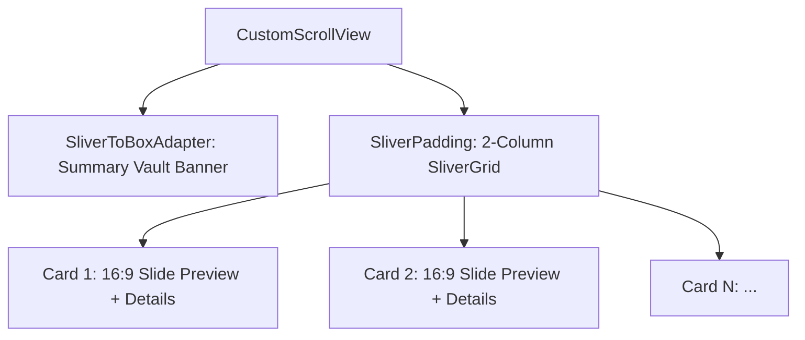

# Presentation Vault: 2-Column Visual Grid & 16:9 Previews

## Architectural Overview

The **Presentation History Screen** ([lib/screens/history_screen.dart](file:///e:/Abdulrahman/imagineX/lib/screens/history_screen.dart)) serves as the persistent local storage showcase for generated presentation decks. To elevate user experience from a generic text-heavy list, the screen was completely redesigned into an authentic 2-column visual grid inspired by modern creative platforms (Pitch, Canva, Apple Keynote).

---

## 1. Grid Layout Geometry & Responsiveness

- **Container:** `CustomScrollView` with `SliverPadding` and `SliverGrid`.
- **Cross Axis Count:** 2 columns.
- **Cross Axis Spacing:** `14.0px`.
- **Main Axis Spacing:** `14.0px`.
- **Child Aspect Ratio:** `0.69` (precision-calculated to house both the top 16:9 preview and bottom metadata without overflow on mobile viewports).
- **Bottom Clearance:** `96.0px` bottom padding to clear the floating capsule bottom bar.

---

## 2. 16:9 Miniature Slide Preview Engine

Each card features a dedicated 16:9 aspect ratio presentation canvas positioned at the top:
1. **Dynamic Color Theme & Gradient Synthesis:**
   - Parses the presentation's template colors (`backgroundStart`, `backgroundEnd`, `background`, `accent`, `title`, `body`).
   - Specifically detects **Modern Violet** templates, rendering deep purple luxury gradients (`#2E1065` to `#1E1B4B`) with radiant violet (`#A855F7`) ambient glows.
2. **Miniature Presentation Elements:**
   - **Header Badges:** Translucent "DECK" tag with template status dot and "16:9" ratio pill.
   - **Slide Title:** Rendered in authentic template title color and font (`GoogleFonts.outfit`, 10px bold).
   - **Accent Underline:** Template accent underline bar (18px × 1.5px).
   - **Body Structure:** Miniature bullet points with 3px circular colored glyphs and text snippets, or image placeholder for media-heavy layouts.
3. **Card Boundary Separation:**
   - Subtle 1px translucent bottom separator (`Colors.black12`) dividing the slide canvas from card details.

---

## 3. Metadata, Interaction & Actions

1. **Presentation Details:**
   - Topic headline in `GoogleFonts.outfit` (13px bold, max 2 lines, ellipsis).
   - Tag chips row: Slide count badge (`"${slideCount} slides"`) and template name pill.
2. **Timestamp & Deletion:**
   - Relative formatted timestamp: `"Just now"`, `"12m ago"`, `"3h ago"`, or `"Oct 12, 2026"`.
   - Tactile trash delete button with safety confirmation modal (`_confirmDelete`).
   - AppBar "Clear All" action with vault wipe confirmation dialog (`_clearAllHistory`).
3. **Micro-Interactions:**
   - Spring physics scaling via `InteractiveBounce` (`0.97x` on card, `0.88x` on delete).
   - Staggered entrance choreographies (`fadeIn` + `scale`).

---

## 4. Verification & Health

- **Unit Test Coverage:** [test/history_data_test.dart](file:///e:/Abdulrahman/imagineX/test/history_data_test.dart) (10/10 tests passed).
- **Static Analysis:** `flutter analyze` passing with **0 errors and 0 warnings**.
