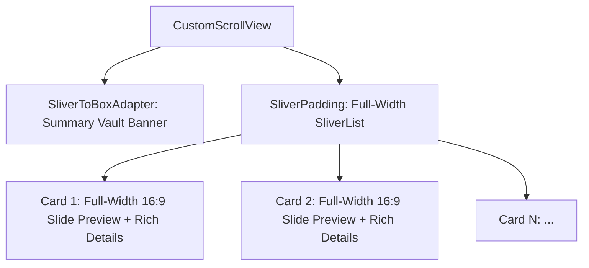

# Presentation Vault: Full-Width Widescreen Cards & 16:9 Previews

## Architectural Overview

The **Presentation History Screen** ([lib/screens/history_screen.dart](file:///e:/Abdulrahman/imagineX/lib/screens/history_screen.dart)) serves as the persistent local storage showcase for generated presentation decks. Following user feedback, cards now span the full width of the screen (`100% width` with uniform 20px padding) rather than being cramped into narrow half-width grid tiles.

---

## 1. Full-Width Card Architecture

- **Container:** `CustomScrollView` with `SliverPadding` and `SliverList.separated`.
- **Card Width:** Full screen width (`double.infinity` constrained by 20px horizontal screen margins).
- **Inter-Card Spacing:** `16.0px` vertical separator between cards.
- **Card Container Styling:** Pure white surface (`AppColors.surface`), 20px rounded corners, dual multi-layered subtle elevation shadows, and delicate Slate-200 boundary borders.
- **Bottom Clearance:** `96.0px` bottom padding to clear the floating capsule bottom bar.

---

## 2. Full 16:9 Widescreen Miniature Slide Preview Engine

Each card features a full-width, true 16:9 widescreen presentation canvas at the top:
1. **Dynamic Color Theme & Gradient Synthesis:**
   - Parses the presentation's template colors (`backgroundStart`, `backgroundEnd`, `background`, `accent`, `title`, `body`).
   - Recognizes **Modern Violet** templates, rendering deep purple luxury gradients (`#2E1065` to `#1E1B4B`) with radiant violet (`#A855F7`) accents.
2. **Proportionate Presentation Elements:**
   - **Header Badges:** Translucent "AI DECK" pill with template accent indicator dot and "16:9 Widescreen" ratio pill.
   - **Slide Title:** Rendered in authentic template title color and font (`GoogleFonts.outfit`, 14px bold).
   - **Accent Underline:** Template accent underline bar (28px × 2px).
   - **Body Structure:** Clean bullet points with 4px circular colored glyphs and text snippets (up to 3 bullets), or image preview badge for media-rich slides.
3. **Card Boundary Separation:**
   - Translucent 1px bottom divider dividing the slide canvas from card details.

---

## 3. Metadata, Interaction & Actions

1. **Presentation Details:**
   - Topic headline in `GoogleFonts.outfit` (16px bold, max 2 lines, ellipsis).
   - Tag chips row: Slide count badge (`"${slideCount} slides"`), template name pill, and `"16:9 PPTX"` format tag.
2. **Timestamp & Direct Actions:**
   - Relative formatted timestamp: `"Just now"`, `"12m ago"`, `"3h ago"`, or `"Oct 12, 2026"`.
   - "Open" action button pill with primary brand orange container and arrow icon.
   - Tactile trash delete button with safety confirmation modal (`_confirmDelete`).
   - AppBar "Clear All" action with vault wipe confirmation dialog (`_clearAllHistory`).
3. **Micro-Interactions:**
   - Spring physics scaling via `InteractiveBounce` (`0.98x` on card, `0.88x` on delete).
   - Staggered entrance choreographies (`fadeIn` + `slideY`).

---

## 4. Verification & Health
- **Static Analysis:** Verified with `flutter analyze` (**0 errors, 0 warnings**).
- **Unit & State Tests:** Verified with `flutter test` (**14/14 tests passing**).

